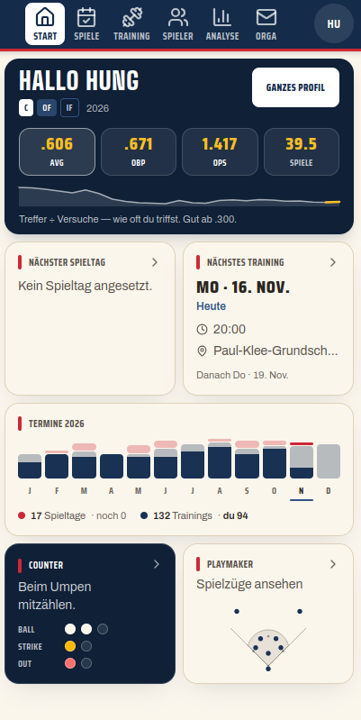
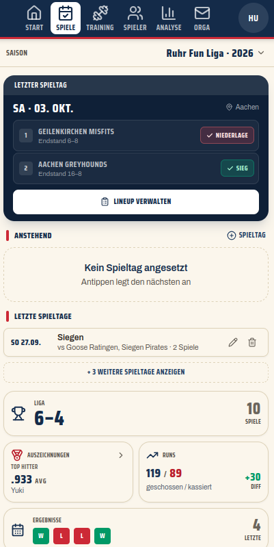
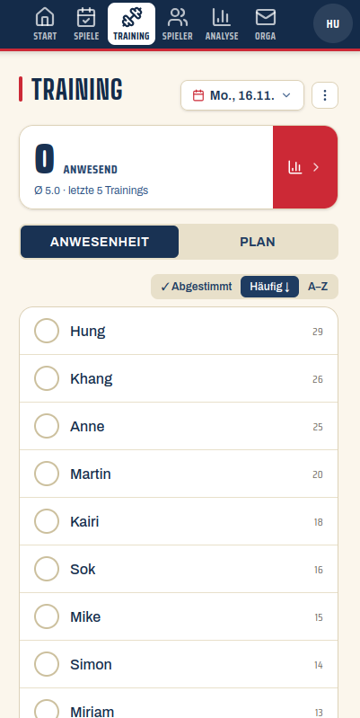
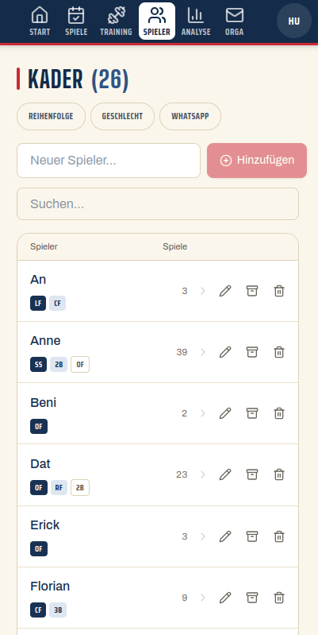
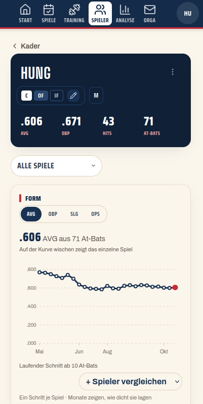
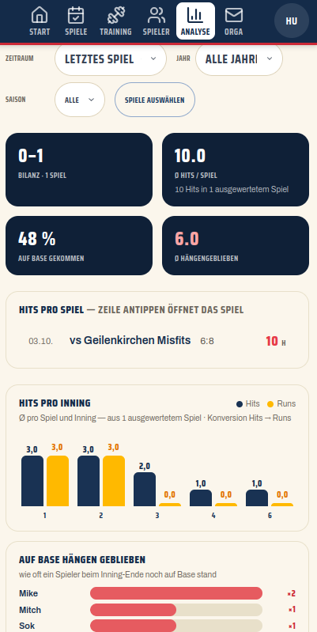
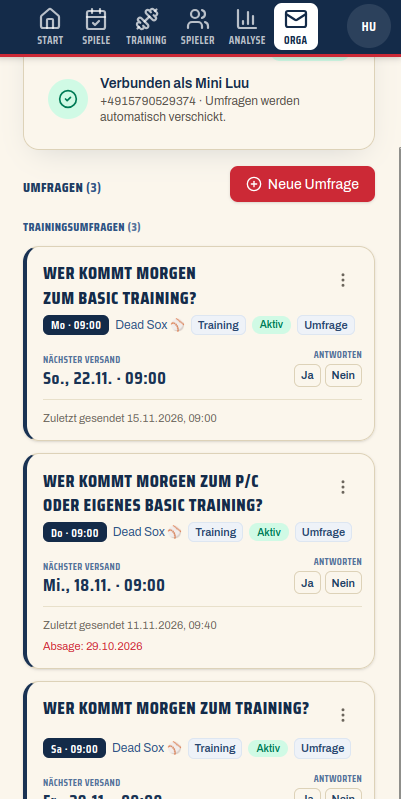
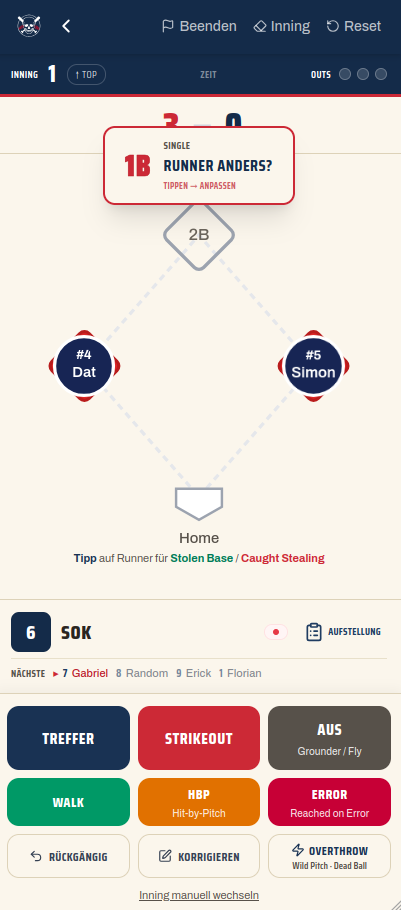

# Softball Planner

Planungstool für Softball-Teams. Verwaltet Saisons, Spieltage, Lineups, Training, Liga-Tabelle und Live-Scoring — für das Team "Dead Sox".

## Demo-Zugang

Testaccount zum Reinschnuppern (Rolle Spieler, eingeschränkte Rechte):

```
Benutzername: random
Passwort:     Deadsox123!
```

### Rollen

Die App kennt drei Rollen (`SUPERADMIN > ADMIN > PLAYER`). Für den Alltag zählen zwei:

| Rolle | Darf |
|-------|------|
| **Admin / Trainer** | Saisons, Spieltage, Lineups, Kader, Training, Liga-Tabelle anlegen & bearbeiten; Live-Scoring führen |
| **Spieler** | Eigenes Profil & eigene Zahlen sehen (Form, Einsätze, Trainingsbeteiligung), Spieltage & Trainingstermine einsehen, zum Umpiren mitzählen |

Jeder Account hängt an genau einem Spieler im Kader — Spieler sehen nur, was sie über sich selbst sehen dürfen, Trainer sehen das ganze Team.

## Was kann die App?

### Start — alles auf einen Blick

Eigene Form (AVG/OBP/OPS), nächster Spieltag, nächstes Training, das Trainingsjahr als Balken, Umpire-Zähler und Playmaker griffbereit — sofort nach dem Einloggen.



### Spieltage & Liga

Spieltage mit Datum und Ort, mehrere Spiele pro Tag (Doubleheader), Ergebnisse, Liga-Tabelle und Season-Kennzahlen (Bilanz, Top-Hitter, Run-Differenz) auf einen Blick.



**Lineup-Editor** (nicht im Bild, Admin-only): Spieler per Klick ins Lineup, Positionen zuweisen, Batting Order per Drag & Drop, Designated Hitter (DH) als Annotation auf einem Feldspieler, Base Coaches, Auto-Aufstellung nach Trainingsbeteiligung und Frauen-Quote, Lineup vom letzten Spiel kopieren oder zwischen zwei Spielen tauschen.

### Training

Anwesenheit pro Training erfassen, sortiert nach Trainingshäufigkeit, Trainings-Zeiträume mit Wochentag-Uhrzeiten, automatische Unterscheidung Basic/Pitcher-Catcher.



### Kader

Spieler-Pool mit Positionsprofil (Primär/Sekundär/Tertiär), Spielanzahl, Geschlecht (für die Frauen-Quote in der Auto-Aufstellung), Sortierung nach Einsätzen — wer am wenigsten gespielt hat, steht oben.



### Spielerprofil

Form-Kurve als gleitender Schnitt (AVG/OBP/SLG/OPS), Hits, At-Bats, Positionen, Spielervergleich.



### Analyse

Statistiken über Zeiträume hinweg: Bilanz, Hits pro Spiel, Hits pro Inning, Auf-Base-Gestrandete pro Spieler — filterbar nach Saison, Jahr oder einzelnen Spielen.



### Orga — WhatsApp-Umfragen

Automatischer Versand von Trainings-Umfragen per WhatsApp ("Wer kommt morgen zum Training?"), Antworten laufen direkt in die Anwesenheit ein — kein manuelles Abtippen mehr. Die Trainingsbeteiligung daraus fließt wiederum in die Auto-Aufstellung fürs Spiel ein: wer seltener da war, wird bevorzugt aufgestellt.



### Live-Scoring

Pitch-by-Pitch-Scoring während des Spiels: Treffer, Strikeout, Aus, Walk, HBP, Error, Overthrow, Stealing, Undo für alle Eingabetypen, automatischer Innings-Wechsel.



### Weitere Funktionen
- **Export:** Druckoptimiertes Lineup- & Scoring-Sheet (PDF), Datenbank als JSON exportieren/importieren
- **Trainerabrechnung:** Stundenzettel für den Hochschulsport, automatisch aus geplanten Trainings berechnet
- **Playmaker:** 2D-Spielzug-Board zum Zeigen und Durchspielen von Cut-off/Relay-Situationen
- **PWA:** installierbar, Offline-Grundfunktionen

## Architektur

Das Backend folgt einer **Onion / Hexagonal Architecture** mit klarer Schichtentrennung:


| Schicht | Inhalt |
|---------|--------|
| **Domain** (innen) | Models, Repository-Ports, Domain Services (LineupValidator, LineupSuggestionEngine, StandingsCalculator, ...) |
| **Application** (mitte) | @Service-Klassen für Orchestrierung & Transaktionen |
| **Adapter** (aussen) | REST-Controller (Inbound), Repository-Adapter + Entities + Mappers (Outbound/JPA) |

> Abhängigkeiten zeigen immer nach innen. Repository-Adapter implementieren Domain-Ports (Dependency Inversion).

Die editierbare Version des Diagramms liegt unter [`docs/architecture.excalidraw`](docs/architecture.excalidraw) und kann in [excalidraw.com](https://excalidraw.com) geöffnet werden.

## Tech-Stack

| Bereich | Technologie |
|---------|-------------|
| Frontend | React 19, TypeScript, Vite 7, Tailwind CSS v4, React Router DOM 7, @dnd-kit, jsPDF |
| Backend | Spring Boot 3.4, Java 21, Spring Security, Spring Data JPA, Spring AI (optional) |
| Datenbank | PostgreSQL 17 |
| Migrationen | Flyway |
| Tests | JUnit, Testcontainers (PostgreSQL), Playwright (E2E) |

## Lokal starten

### Voraussetzungen
- Java 21
- Node.js
- Docker

### 1. Datenbank starten

```bash
docker compose up -d db
```

Startet PostgreSQL auf Port 5432 (User: `softball`, Passwort: `softball`, DB: `softball`).

### 2. Backend starten

```bash
cd backend
./mvnw spring-boot:run -s .mvn/local-settings.xml
```

Nutzt `local-settings.xml` statt der globalen Maven-Settings (`~/.m2/settings.xml` zeigt auf einen Nexus und darf nicht verändert werden). Flyway erstellt beim ersten Start automatisch alle Tabellen.

### 3. Frontend starten (Entwicklung)

```bash
cd frontend
npm install
npx vite
```

Frontend: `http://localhost:5173` · Backend: `http://localhost:8080`
Der Vite Dev-Server proxied `/api` automatisch ans Backend.

### Login lokal

Passwörter aus den Umgebungsvariablen `APP_AUTH_PASSWORD` (Superadmin) und `APP_PLAYER_PASSWORD` (an den Kader verteilt). Benutzername ist der Vorname des Spielers.

## Tests

```bash
cd backend
./mvnw test -s .mvn/local-settings.xml
```

Integration-Tests laufen gegen eine echte PostgreSQL via Testcontainers (Docker muss laufen).

```bash
cd frontend
npm run test:e2e
```

Playwright-E2E-Suite fürs Live-Scoring (Refactor-Sicherheitsnetz).

## Deployment

Die App läuft auf einem **Hetzner VPS** (Docker Compose) unter https://softball-planner.duckdns.org.

### Stack
- **Backend + Frontend:** Spring Boot JAR (Frontend als statische Resources) im Docker-Container
- **Datenbank:** PostgreSQL 17 im Docker-Container
- **Reverse-Proxy:** Nginx mit SSL (Let's Encrypt, auto-renewal via certbot)
- **Domain:** DuckDNS

### Wie es funktioniert
- Push auf `master` → GitHub Action → SSH zum Server → `/opt/softball/deploy.sh`
- Deploy-Script: `git pull` → `docker build` → `docker compose up -d backend`
- Dockerfile baut Frontend + Backend in ein JAR
- Flyway migriert die Datenbank beim Start
- Umgebungsvariablen in `/opt/softball/docker-compose.yml`: `DATABASE_URL`, `DATABASE_USER`, `DATABASE_PASSWORD`, `APP_AUTH_PASSWORD`, `APP_PLAYER_PASSWORD`, `GEMINI_API_KEY`, optional `AI_ENABLED` + `GROQ_API_KEY`

### Produktions-Build lokal testen

```bash
cd backend
./mvnw package -s .mvn/local-settings.xml -DskipTests
java -jar target/lineup-planner-0.0.1-SNAPSHOT.jar --spring.profiles.active=prod
```
